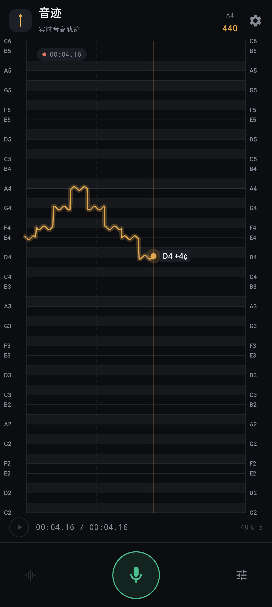
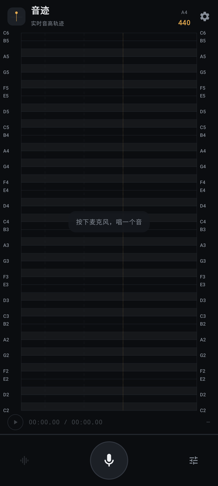

# 音迹 · PitchTrace

简体中文 | [English](#english)

[](https://github.com/ahooop/pitchtrace/actions/workflows/android.yml)
[](LICENSE)

用手机麦克风实时检测音高，把声音画成钢琴卷帘上的“音迹”——横轴是时间，纵轴是音高，
当前时刻固定在偏右的竖线上，轨迹向左滚动，同时支持录下这一段声音并回放。

<a id="english"></a>

## English

**PitchTrace** ("sound trace") draws what it hears: the phone microphone drives real-time pitch detection, plotted on a piano roll — time on the X axis, pitch on the Y axis, the current moment pinned to a line at the right while the trace rolls left. A take can be recorded and played back against the same pitch trace.

- **Detection** — YIN (difference function → cumulative mean normalization → threshold dip → parabolic interpolation) in pure Kotlin, no NDK. 48 kHz capture decimated 2× to 24 kHz; ~10 ms per frame, ~50 ms latency including the analysis window
- **Anti-glitch** — confidence + RMS double gate (silence draws nothing), octave-error folding, 3-point median smoothing
- **Piano roll** — a single Canvas; the trace is one `Path` stroked twice (glow + line), with a semitone grid, second markers and note names on both edges
- **Ranges and tuning** — E1–C4 / C2–C6 / G3–C7 / C1–C7; A4 415–466 Hz (440 by default, 442 for orchestras)
- **Recording** — WAV plus a binary pitch track (`take.pitch`: timestamp, pitch, confidence); playback restores the trace on the same time axis, no re-analysis
- **Testing** — `core/dsp` and `core/pitch` carry no Android dependencies, so the pitch logic is unit-tested on the JVM; UI regressions are caught by Robolectric screenshot tests that render the real Compose screen in CI

Install the signed APK from [Releases](https://github.com/ahooop/pitchtrace/releases) (Android 8.0+). Releases are built and published by CI whenever a `v*` tag is pushed. Build with JDK 17 and Android SDK 35: `./gradlew assembleDebug`. MIT.

Known limits: phone microphone response rolls off below C2, so octave errors can still slip through there (folded, but not eliminated); only the latest take is kept.

## 界面

| 采集中 | 待机 |
| --- | --- |
|  |  |

截图由 `ScreenScreenshotTest` 用 Robolectric 原生图形模式把真实 Compose 界面渲染出来，
不是设计稿；重新生成：`./gradlew :app:testDebugUnitTest`，产物在 `app/build/screenshots/`。

## 功能

- **实时音高**：YIN 基频检测，约 10ms 输出一次，延迟 ≈ 50ms（含分析窗）
- **钢琴卷帘**：半音网格、左右音名标注、秒线、当前音名与光标
- **音域档位**：低音 E1–C4 / 人声 C2–C6 / 高音 G3–C7 / 全音域 C1–C7
- **A4 校准**：415–466 Hz 可调（默认 440，管弦乐队常用 442）
- **录音回放**：采音同时写 WAV，音高轨迹单独落盘，回放时按时间轴还原，不需要重新分析
- **抗误判**：八度误判纠正、三点中值平滑、置信度与 RMS 双门限（静音不画线）

## 技术要点

| 关注点 | 做法 |
| --- | --- |
| 采集 | `AudioRecord`，48kHz 单声道 PCM16，优先 `UNPROCESSED` 音源关闭 AGC/降噪/回声消除 |
| 检测 | YIN：差分函数 → 累积均值归一化 → 阈值取谷 → 抛物线插值，纯 Kotlin 实现 |
| 降采样 | 整数抽取 2 倍到 24kHz，运算量减半，精度靠插值保住 |
| 平滑 | 置信度门限 → 八度折叠 → 三点中值 |
| 渲染 | 单 Canvas 绘制，轨迹为一条 `Path`，光晕 + 实线两次描边 |
| 状态 | 音频线程只投递样本，30Hz 合并下发 `StateFlow`，避免 93Hz 触发 Compose 重组 |
| 存储 | `filesDir/takes/take.wav` + `take.pitch`（自定义二进制，含时间戳/音高/置信度） |

## 目录结构

```
app/src/main/java/com/pitchtrace/app/
├── core/dsp/        YinPitchDetector.kt   纯算法，无 Android 依赖
│                    PitchAnalyzer.kt      分帧 / 抽取 / RMS 门限
├── core/pitch/      Music.kt             频率 ↔ MIDI ↔ 音名
│                    PitchTracker.kt      八度纠正 + 中值平滑
│                    PitchRange.kt        音域档位
├── core/audio/      AudioCapture.kt      AudioRecord 封装
│                    WavCodec.kt          WAV 读写
│                    PlaybackEngine.kt    AudioTrack 流式回放
├── core/store/      SessionStore.kt      录音会话落盘
├── ui/              PianoRoll.kt         卷帘绘制
│                    PitchTraceScreen.kt  主界面 / 播放条 / 设置面板
├── PitchViewModel.kt                     编排层
└── MainActivity.kt                       权限与入口
```

`core/dsp` 与 `core/pitch` 不依赖 Android，所以音准逻辑可以在 JVM 上直接单测。

## 下载

- **[最新 Release](https://github.com/ahooop/pitchtrace/releases/latest)**：`pitchtrace-x.y.z.apk`，RSA 签名，直接在手机上安装（Android 8.0+，需允许未知来源）
- 不想装也可以先看上面两张界面截图

## 构建

需要 JDK 17、Android SDK（platform 35、build-tools 35）、Gradle 8.9（仓库自带 wrapper）。

```bash
./gradlew assembleDebug          # 产物 app/build/outputs/apk/debug/app-debug.apk
./gradlew testDebugUnitTest      # DSP / 音准单测 + 界面截图
```

单元测试覆盖：440Hz / C2 / C6 的音分误差、静音与白噪声不误报、八度误判折叠、单帧跳点平滑、
采集率 48k→分析率 24k 的端到端流程。

`local.properties` 里的 `sdk.dir` 指向本机 Android SDK，不要提交。

### GitHub Actions 自动打包

提交代码后不需要本地打包，两个工作流各管一段：

| 工作流 | 触发 | 产物 |
| --- | --- | --- |
| [Android CI](.github/workflows/android.yml) | push 到 `main`、PR、手动 | 单元测试 + debug APK + 界面截图，在 Actions 运行的 Artifacts 里下载 |
| [Release](.github/workflows/release.yml) | 推送 `v*` tag、手动触发 | release APK，自动创建 GitHub Release 并生成变更说明 |

发版就是打 tag：

```bash
git tag v0.1.1
git push origin v0.1.1
```

也可以在 Actions → Release → Run workflow 里手填版本号触发（不需要先建 tag）。

CI 签名读仓库 Secrets（Settings → Secrets and variables → Actions），四个都要配齐：

| Secret | 内容 |
| --- | --- |
| `RELEASE_KEYSTORE_BASE64` | keystore 文件的 base64，单行 |
| `STORE_PASSWORD` | keystore 密码 |
| `KEY_ALIAS` | key 别名 |
| `KEY_PASSWORD` | key 密码 |

生成 base64：

```powershell
[Convert]::ToBase64String([IO.File]::ReadAllBytes("keystore/pitchtrace-release.jks"))
```

```bash
base64 -w0 keystore/pitchtrace-release.jks
```

没配 `RELEASE_KEYSTORE_BASE64` 时工作流不会失败，但产物会命名成 `pitchtrace-x.y.z-unsigned.apk`，Release 说明里也会标注「未签名，无法直接安装」。

## 安装

```bash
adb install -r app/build/outputs/apk/release/app-release.apk    # 正式签名
adb install -r app/build/outputs/apk/debug/app-debug.apk        # debug，包名带 .debug 可与正式版共存
```

或者把 APK 拷到手机上手动安装。

自己打 release 包需要 `keystore.properties`（不入库）：

```properties
storeFile=keystore/pitchtrace-release.jks
storePassword=******
keyAlias=pitchtrace
keyPassword=******
```

没有这个文件时 `assembleRelease` 产出未签名 APK，`assembleDebug` 不受影响。

## 参数与限制

- 低频（C2 以下）受手机麦克风频响限制，偶尔会掉到八度关系上，已加折叠纠错，但仍不如右声道电容麦
- 分析窗 40–50ms，快速滑音会被“抹平”一点，这是精度和延迟的取舍
- 录制只保留最近一条（`take.wav`），再次录音会覆盖
- 暂不支持导出/分享音频、节拍器、音阶训练

## 后续可做

- 录音列表与导出（MediaStore / 分享）
- 频谱瀑布图
- 音准打分、音域统计（唱到的最低/最高音）
- 使用 `Oboe` 或 `AudioRecord` 的 `AAudio` 低延迟路径

## 许可证

[MIT](LICENSE) © 2026 ahooop

欢迎提 issue / PR。真机适配（不同厂商的麦克风与 UNPROCESSED 音源支持）是最需要反馈的部分。
